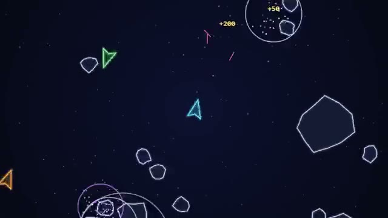

# Rock Rumble

Blast the rocks. Blast each other. Three ships. A multiplayer starter game from [Multiplayer Agent](https://multiplayeragent.com): 2D, drop-in, 2–12 players, with bots that fill empty seats.

## How it plays

Thrust and turn through a field that wraps at every edge. Big rocks split into smaller, faster ones worth more points. Down another ship for 200. You get three ships a run; touch a rock or a bullet and you lose one.

**Controls:** Arrow keys or the mouse to turn, Up or right-click to thrust, Space or click to shoot; thumb stick and FIRE on touch.

## Make it yours in the Game Builder

Open the [Game Builder](https://multiplayeragent.com), choose **Start from a starter game** and pick Rock Rumble. It opens as version 1 in your studio, ready to play and publish. Then ask for changes, for example:

- Add a shield pickup that floats out of broken rocks
- Make it underwater, with submarines and jellyfish
- Add a black hole in the middle that pulls everything in

## Run it yourself

1. Get a free publishable key (`pk_…`) at [multiplayeragent.com](https://multiplayeragent.com).
2. In `index.html`, put it in place of `pk_REPLACE_ME` in the `MP_CONNECT` block.
3. Open `index.html` in a browser. No build step and no server needed.

Without a key it still runs, offline against bots.

## How it is built

- One `index.html`. The comment at the top of the script maps the code and explains the multiplayer.
- **Leaderboard:** Each player's best score in one run of three ships.
- **Host-run rules:** The host's browser flies the rocks and decides who broke them; if it leaves, the next player takes over.
- **Bots:** Bot ships fill the field until enough people join.
- **Live sync:** Every ship, rock and bullet moves for everyone at once; whoever gets hit says so.
- `?attract` runs it offline with bots only. The preview video is recorded from it.

## License

MIT.
